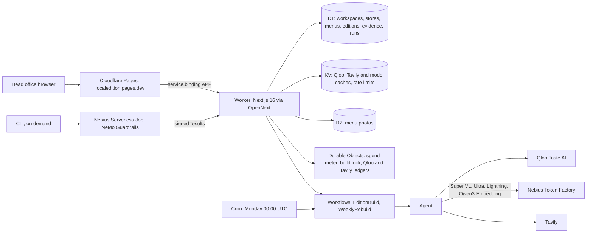

# Architecture

## Pieces

| Piece | Where | Notes |
|---|---|---|
| Web app and API | `src/app/`, `src/components/`, `src/server/` | Next.js 16 on a Cloudflare Worker through `@opennextjs/cloudflare`. Node runtime, `nodejs_compat`. All API inputs are validated with zod; errors are `{ error, code }`, never a stack or an upstream body. |
| Public front | `edge/pages/` | A Pages project whose `_worker.js` forwards every request over the `APP` service binding and re-sets `cf-connecting-ip` (rate limits key on it). The Worker itself has no public `workers.dev` address. |
| Contract | `src/contract/` | zod schemas for the domain, the streamed agent events and every route; the UI's typed client and mock data are built from them. |
| Qloo | `src/server/qloo/` | Client, ledger, block profile, places, artists, brands, search, compare, rising. See [QLOO.md](QLOO.md). |
| Agent | `src/server/agent/` | Tool loop, evidence verifier, copy, guardrails, review. See [AGENT.md](AGENT.md). |
| Models | `src/server/tokenfactory/` | OpenAI-compatible client for Nebius Token Factory with a spend meter (reserve then settle), model availability checks and menu-photo reading. |
| Tavily | `src/server/tavily/` | Weekly local events (search, extract, Lightning triage) and the brand-voice crawl, behind its own credit ledger. |
| Guardrails | `src/server/guardrails/`, `guardrails/`, `jobs/` | Live TypeScript mirror plus Lightning self-check; the NeMo Guardrails library in a Nebius job. |
| Builds | `src/server/workflows/` | `EditionBuild`: one retried step per store, events written to D1 and tailed over Server-Sent Events, so a dropped connection replays what it missed. `WeeklyRebuild`: the Monday cron rebuilds the demo workspace. |
| Storage | `src/server/store/`, `migrations/` | One repository interface with D1 (production), KV, file and memory drivers. Every visitor row carries `workspace_id`; expired visitor workspaces are purged by the weekly cron. |
| Connectors | `src/server/connectors/` | A private `.ics` calendar feed per store with its event night. The folder also holds connector modules for Square, Slack and Gmail/Outlook (through Composio). |
| Accounts | `src/server/auth/` | Email and password (PBKDF2), optional emailed sign-in codes, guest sessions for "Try the sample chain". |

## Data model (short)

Defined in `src/contract/domain.ts`.

- **Chain**: name, category, brand voice lines, up to 3 **anchors** (Qloo brand entities it resembles), city.
- **Store**: neighbourhood name, corner, latitude and longitude.
- **Edition**: one per store per week; up to four **items** (special, sound, partner, event), the **evidence** rows they cite, the model that planned and wrote it, and the chain review.
- **Evidence**: source (`qloo`, `tavily`, `tokenfactory`), endpoint path, parameters, summary, metrics, entity ids, when it was fetched, and whether it is `live` or `cache`.
- **Staff card**: a phone-first page per approved edition, at a public token link.

## Streamed events

A build or regenerate streams `AgentEvent`s (`src/contract/events.ts`): `run_started`, `store_started`, `tool_call`, `tool_result`, `item_drafted`, `guardrail`, `step_metrics` (model, tokens and cost per call), `review`, `progress`, `store_done`, `run_done`, and `error` (with codes such as `item_dropped`, `step_skipped`, `model_unavailable`, `spend_cap`).

## Main routes

| Route | What |
|---|---|
| `POST /api/auth/guest` | "Try the sample chain": a guest session on a private copy of the sample chain |
| `GET /api/workspace` | chain, stores, menu, latest editions |
| `GET /api/anchors/search?q=` | Qloo `/search` for brands (cache first, ledger and per-workspace limit) |
| `GET /api/stores/:id/profile` | a store's block profile with evidence |
| `GET /api/compare?a=&b=` | two stores compared, with Qloo's compare as evidence |
| `POST /api/editions/build` | build this week's editions (SSE) |
| `POST /api/editions/:id/items/:itemId/regenerate` | another take on one item (SSE) |
| `PATCH /api/editions/:id/items/:itemId` | approve, reject or edit (`If-Match` version required; edits are re-checked by guardrails) |
| `POST /api/editions/review` | the chain review (SSE) |
| `GET /api/editions/:id/card`, `GET /api/card/:token` | staff card, and its public view once approved |
| `GET /api/status` | provider modes |
| `GET /api/runs` | the workspace's build runs and their events (the Runs view) |
| `POST /api/jobs/*` | signed (HMAC) job routes: the Monday build trigger and NeMo job results |

## Schedules

- Cloudflare cron `0 0 * * MON` (Monday 08:00 in Kuala Lumpur) starts `WeeklyRebuild` for the demo workspace and purges expired visitor workspaces. It calls Qloo, Token Factory and Tavily only.
- NeMo Guardrails certification and eval run in a Nebius Serverless Job started from the CLI; the Worker cannot reach Nebius's control plane, so it is never on a schedule.
